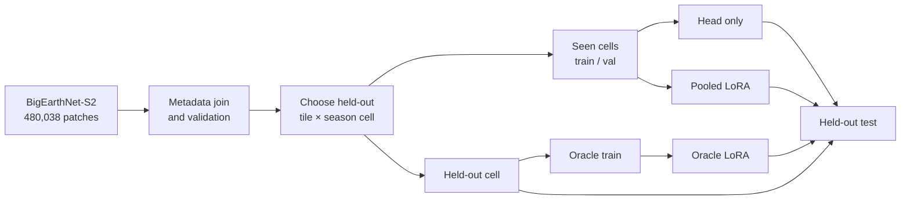

# Glue

BigEarthNet-S2 data preparation and controlled model-adaptation experiments.

Glue builds tile–season compositional splits of BigEarthNet-S2 and prepares multi-label Sentinel-2 RGB inputs. It then compares classifier-head training with low-rank convolutional adapters on a frozen ResNet-50, under an explicit model-selection protocol. It is a small research codebase with tests and NCI Gadi job templates. It is not a framework, and the only reported numbers are explicitly labelled historical exploratory runs.

```bash
pip install -r requirements.txt     # with a PyTorch/torchvision build for your platform
python -m pytest tests              # 46 offline CPU tests on synthetic data, ~1 min
```

## At a glance

| | |
|---|---|
| **Research question** | When a satellite-image classifier has seen a tile and a season separately, but never that combination, how much does a small adapter trained on pooled seen data recover, compared with one trained on data from the unseen combination itself? |
| **Approach** | Hold out one (tile, season) cell of BigEarthNet-S2. Compare three models on the held-out cell: a frozen ResNet-50 with only its head trained, a pooled model with LoRA-style adapters trained on seen cells, and an oracle with the same adapters trained on part of the held-out cell |
| **Built** | A metadata pipeline over 480,038 patches, two compositional split designs (including a label-aware hard split), an RGB multi-label loader, the adapter models with validation-only selection, NCI Gadi job templates, and 46 offline tests |
| **Status** | Exploratory first runs complete on both splits (below). The revised protocol (`protocol_version: 2`) is implemented and tested on synthetic data but has not yet been run on the real dataset |



## Implemented capabilities

| Area | What exists | Where |
|---|---|---|
| Metadata | Join `metadata.parquet` to local patch folders; derive tile, date and season from patch IDs. Validation report: required columns, empty values, missing band files, tile-ID format, month validity and month→season consistency | `src/data/build_ben_s2_metadata.py`, `validate_ben_s2_metadata.py` |
| Split design | Rank candidate held-out (tile, season) cells by size and label-distribution divergence; write a fixed seeded split. A label-aware variant also checks label coverage of the held-out test subset | `src/data/recommend_ben_s2_split_candidates.py`, `create_ben_s2_first_split.py`, `recommend_ben_s2_label_aware_candidates.py`, `create_ben_s2_labelhard_split.py` |
| Portability | Copy the selected patches (optionally RGB bands only) with relative paths for transfer to HPC | `src/data/export_ben_s2_subset.py` |
| Loading | RGB (B04/B03/B02) tensors, reflectance clipped to [0, 10000] and scaled to [0, 1], bilinear resize to 224; multi-hot labels; path re-rooting via `--data_root` / `BEN_S2_DATA_ROOT` | `src/data/ben_s2_dataset.py`, `check_ben_s2_loader.py` |
| Adaptation | Frozen ResNet-50 (BatchNorm statistics frozen too) with a new linear head; optional `LoRAConv2d` adapters (below) | `src/training/train_baseline.py` |
| Experiment records | `metrics.csv` (one row per split per evaluation, with the checkpoint used), `run_metadata.json` (initialisation, trainable parameters, selection policy, versions), best and last checkpoints | same |
| HPC | PBS templates for NCI Gadi with all paths taken from environment variables | `nci/` |

**`LoRAConv2d`** wraps a frozen `Conv2d` and adds a residual path `(α/r) · up(down(x))`. Here `down` is a 1×1 convolution to rank `r` with the base layer's stride, and `up` is a zero-initialised 1×1 convolution back to the output channels. The wrapped layer therefore starts as an exact copy of the frozen layer (tested). It is a low-rank convolutional residual adapter in the spirit of LoRA, not a low-rank factorisation of the k×k kernel. With the defaults (rank 4, all 10 convolutions in `layer4`), the adapters add 81,920 trainable parameters, 0.35% of the frozen ResNet-50.

## Experimental design

The first split (`create_ben_s2_first_split.py`) holds out one (tile, season) cell, `T29SND_summer`. Training uses `T29SND_spring`, `T29SND_autumn` and `T29SNC_summer`, so the model has seen the tile and the season but not the combination.

| Split | Contents |
|---|---|
| `train_seen` / `val_seen` | Random 90/10 split of the three training cells (seed 0) |
| `test_unseen` | The whole held-out cell |
| `oracle_train_unseen` / `oracle_test_unseen` | Random 50/50 split of the held-out cell |

| Mode | Trains on | Trainable | Checkpoint selection | Final evaluation (once, after training) |
|---|---|---|---|---|
| `head_only` | `train_seen` | linear head | best `val_seen` macro mAP | `test_unseen`, `oracle_test_unseen` |
| `pooled_lora` | `train_seen` | head + adapters | best `val_seen` macro mAP | `test_unseen`, `oracle_test_unseen` |
| `oracle_lora` | `oracle_train_unseen` | head + adapters | none: fixed number of epochs (there is no oracle validation split) | `oracle_test_unseen` |

`oracle_lora` is a reference for how much in-domain data from the unseen combination helps. Compare it with the other modes on `oracle_test_unseen`, which all three report. Because it is not validation-selected, it is a fixed-epoch diagnostic, not a tuned upper bound.

**Metrics:**

- macro mAP (average precision per class);
- micro-F1;
- macro-F1 at a fixed 0.5 threshold.

Macro averages include only classes with at least one positive in the evaluated split; `n_classes_evaluated` records how many.

## Label-aware hard split and historical runs

A second, label-aware split holds out `T29UPU_spring` and trains on `T29UPU_summer`, `T29UPU_winter` and `T29SND_spring`. Unlike the first split, the held-out cell is divided 80/20, and `test_unseen` and `oracle_test_unseen` are the same 20% subset, so all three models are scored on identical samples. The seed-0 split contained 21,299 training, 2,367 validation, 6,462 oracle-training and 1,616 shared held-out test samples. The test set contained 17 of 19 labels; Coastal wetlands had one positive. The label-distribution Jensen–Shannon divergence between seen training and test was 0.0811.

```bash
python -m src.data.recommend_ben_s2_label_aware_candidates --metadata_csv outputs/ben_s2_clean_metadata.csv
python -m src.data.create_ben_s2_labelhard_split --metadata_csv outputs/ben_s2_clean_metadata.csv
```

The candidate recommender uses the seeded test subset's labels to choose cells. This is exploratory test-set-informed design; freeze the split and selection criteria before subsequent evaluation. Geographic proximity and independence are not established by tile IDs alone.

Earlier Gadi runs on this hard split recorded the following **exploratory legacy-protocol, seed-0, final-epoch** metrics. These are not protocol-version-2 benchmarks:

| Model | mAP | Micro-F1 | Macro-F1 |
|---|---:|---:|---:|
| Head only | 0.311 | 0.541 | 0.157 |
| Pooled LoRA-style adapter | 0.333 | 0.646 | 0.218 |
| Oracle LoRA-style adapter | 0.343 | 0.687 | 0.222 |

On this split the oracle adapter was about 0.010 mAP above the pooled adapter, and both adapters were above head-only training.

The same legacy pipeline on the first (`T29SND_summer`) split gave:

| Model | mAP | Micro-F1 | Macro-F1 |
|---|---:|---:|---:|
| Head only | 0.340 | 0.372 | 0.196 |
| Pooled LoRA-style adapter | 0.362 | 0.465 | 0.249 |
| Oracle LoRA-style adapter | 0.353 | 0.436 | 0.197 |

On that split the oracle was scored on its 50% test half (4,108 samples), a subset of the pooled and head-only test set (8,216 samples), so its row is not a like-for-like comparison. These observations motivated the label-aware split with a shared test set.

Caveats that apply to both tables: the runs used a random frozen backbone (`--pretrained false`). The legacy oracle evaluated its test set repeatedly and selected checkpoints using test performance, and the old metrics averaged over absent classes. The reported values are the final-epoch (epoch 10) rows of each run's metrics file. These single-seed results should not be interpreted as reliable evidence of an oracle gap or compared directly with the revised protocol. Re-run with the current code, fixed selection, pretrained weights, per-class support and multiple seeds before drawing conclusions.

## Repository structure

```
src/data/            metadata, validation, split design (first and label-aware), export, dataset, loader check
src/training/        train_baseline.py (modes, adapter, selection, metrics)
nci/                 PBS templates, shared job body, environment setup, guide
tests/               offline tests (synthetic data; no downloads)
requirements.txt
```

## Installation

Python 3.9+ (tested locally with 3.12, PyTorch 2.5, torchvision 0.20). Install PyTorch and torchvision for your platform, then `pip install -r requirements.txt`. The NCI templates target the Gadi `pytorch/1.10.0` module with `torchvision==0.11.1` (see `nci/README_NCI.md`).

## Data

[BigEarthNet](https://bigearth.net/) Sentinel-2 (BigEarthNet-S2 with `metadata.parquet` and per-patch band GeoTIFFs) must be obtained separately under its own terms. It is not included or redistributed.

```bash
python -m src.data.build_ben_s2_metadata --data_root <BigEarthNet-S2> --output_dir outputs
python -m src.data.validate_ben_s2_metadata --metadata_csv outputs/ben_s2_clean_metadata.csv
python -m src.data.recommend_ben_s2_split_candidates --metadata_csv outputs/ben_s2_clean_metadata.csv
python -m src.data.create_ben_s2_first_split --metadata_csv outputs/ben_s2_clean_metadata.csv \
  --output_dir outputs/ben_s2_splits_first
python -m src.data.check_ben_s2_loader --split_dir outputs/ben_s2_splits_first
```

The held-out cell is fixed in `create_ben_s2_first_split.py`. The recommender only reports candidates.

## Running experiments

```bash
python -m src.training.train_baseline --mode pooled_lora \
  --split_dir outputs/ben_s2_splits_first --output_dir runs/pooled_lora_seed0 \
  --pretrained true --epochs 10 --lr 1e-4
```

- **`--pretrained` is required.** `true` loads ImageNet weights, or a local file via `--pretrained_weights`, and fails with an error if loading fails; there is no silent random fallback. `false` gives a random frozen backbone, which is only meaningful as a negative control.
- Other options: `python -m src.training.train_baseline --help`.

## NCI Gadi

See [`nci/README_NCI.md`](nci/README_NCI.md). The templates pass `bash -n`, and a dry run of the shared job body with stubbed `module`/`python` is part of the test suite. They have **not** been re-run on Gadi since this revision.

## Verification

`python -m pytest tests` (46 tests, CPU, synthetic data) covers:

- data loading and label mapping;
- split disjointness and the held-out-cell definition;
- all three modes end to end;
- adapter identity at initialisation, shape and stride, gradient flow and unsupported geometries;
- frozen versus trainable parameters and frozen BatchNorm statistics;
- validation-only checkpoint selection, with the selected weights used for test evaluation and test data evaluated once;
- oracle fixed-epoch policy;
- metric handling of absent classes;
- pretrained-loading errors and strict loading from a local file;
- CLI help and argument validation;
- shell syntax and HPC dry run;
- a scan of tracked files for credentials, private IPs and personal paths.

Not verified here: any run on real BigEarthNet-S2 data, GPU-scale training, or a Gadi job.

## Limitations

- No results from the revised protocol are published. Results produced with earlier versions are not comparable: they used a random backbone, oracle selection on test data, last-epoch test evaluation, and AP averaged over absent classes. The current behaviour is `protocol_version: 2`.
- One held-out cell per split and one seed. Patches from the held-out tile appear in training in other seasons, so this tests compositional (tile × season) generalisation, not spatial independence. The random oracle and validation halves contain spatially adjacent patches.
- The label vocabulary is built from the label names in the split files, including test splits. It is not used for selection.
- RGB bands only; no ImageNet mean/std normalisation; fixed 0.5 threshold for F1.
- No hardware or latency measurements; not intended for deployment.

## Attribution

- BigEarthNet: G. Sumbul et al.; see <https://bigearth.net/> for the dataset, licence and the papers to cite.
- [PyTorch](https://pytorch.org/) and [torchvision](https://github.com/pytorch/vision) (ResNet-50 and ImageNet weights); [scikit-learn](https://scikit-learn.org/) metrics; [pandas](https://pandas.pydata.org/), [tifffile](https://github.com/cgohlke/tifffile).
- The adapter follows the low-rank adaptation idea of Hu et al., "LoRA: Low-Rank Adaptation of Large Language Models" (2021), applied to convolutions.
- Developed during PhD research at Deakin University. No licence has been declared yet.
